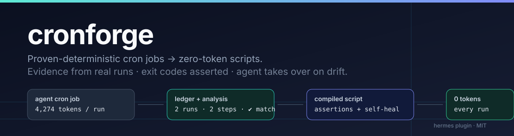

# cronforge

<p align="center"></p>

**Your cron jobs are re-burning tokens to re-do the same shell commands.** cronforge reads
Hermes' own run history, *proves* which jobs are deterministic, compiles them into a plain
Python script with the original exit-code assertions baked in, and hands the job back to the
agent automatically if the world ever stops matching.

> 1 job, 2 recorded runs, 2 commands → **0 tokens per run**, verified. Same job, same output.

```
cronforge_scan      → which jobs are provably deterministic (and what they cost per month)
cronforge_compile   → generate the replay script from real evidence
cronforge_verify    → run it once, right now, and show the result
cronforge_activate  → switch the job to no_agent mode (scheduler runs the script)
cronforge_rollback  → hand the job back to the agent, prompt and delivery intact
```

## Why this is not "just a wrapper script"

Anyone can write `curl … && git pull` into a shell script. The hard part is knowing **which**
job may safely stop using a model — and proving it. cronforge does that with evidence and says
**no** with a reason when the evidence is missing:

| Signal | Verdict |
|---|---|
| 2+ runs with the same ordered commands (glue like `echo`/`cd`/`sleep` ignored, grouping differences normalised) | ✅ compilable |
| arguments differ in non-volatile ways (`gh issue close 12` vs `…47`) | ❌ "a literal replay would be wrong" |
| a `delegate_task`, `vision_analyze`, `web_search` step appears | ❌ "contains model-only tools (judgement work)" |
| only one run observed | ❌ "need at least 2 matching runs" |
| dates / timestamps / pids vary | ✅ compiled as runtime slots (`{{today}}`, `{{now_iso}}`, `{{epoch}}`) |

Volatile slots are only carved out where the runs *actually* differed — a fixed literal date
stays a literal. Secrets are redacted (`[REDACTED]`) before anything touches the ledger.

## Evidence from a real run (Hermes 0.20.2, Windows 11)

```
job: cronforge-demo   schedule: 0 5 * * *
runs recorded: 2 (ledger, via hook)      tokens/run: 4,274
compilable: true    steps: 2    volatile slots: []
→ hermes/scripts/cronforge_f55dbd6db41a.py (127 lines, py_compile ok)
cronforge_verify: {"ok": true, "exit": 0, "steps": 2, "duration_s": 2.11}
   step 1 → C:  465G 253G 213G 55% /c
   step 2 → HTTP/1.1 302 Found
after activate: scheduler ran the script, 0 model calls, script_success logged
failure drill: 2 failing runs → rolled_back automatically, job back in agent mode
```

## Install

```bash
hermes plugins install eike/hermes-cronforge --enable     # or clone into <hermes home>/plugins/cronforge
hermes plugins validate <path to plugin>                  # optional: manifest + security scan
```

Restart once so the tools load (hooks go live immediately), then:

```bash
hermes plugins list        # cronforge enabled
hermes cron list           # pick a job that runs the same commands every time
```

## Usage

Ask Hermes, in plain language:

> "Scan my cron jobs with cronforge and tell me what's deterministic."

Or drive the tools directly:

```
cronforge_scan                       # read-only overview + tokens at stake
cronforge_compile  job_id=<id>       # writes scripts/cronforge_<id>.py, byte-compiles it
cronforge_verify   job_id=<id>       # executes it once — real side effects, on purpose
cronforge_activate job_id=<id>       # no_agent=true + script=…, receipt stored
cronforge_rollback job_id=<id>       # back to the original prompt/delivery/model
```

Anything a script can't reproduce (a model's judgement, a browser login, a price decision)
**must** stay with the agent — cronforge will refuse it and say which tool blocked it.

## How it works

```
post_tool_call hook ──► ledger.jsonl      (job_id + execution_id from ctx.current_cron_execution)
state.db (read-only) ─► history fallback  (jobs that ran before cronforge existed)
                        │
                        ├─ analyze: signatures, glue, volatile slots, blocking tools, cost
                        ├─ codegen: one atomic step per command + exit-code assertions
                        └─ ops: compile → verify → activate (public CLI) → rollback / self-heal
```

* **Evidence, not guesses.** Every verdict cites runs, steps and slots.
* **Self-healing, no watcher.** The generated script counts its own consecutive failures and
  calls `hermes cron edit <id> --agent` after the second one. No daemon, no polling, no
  approval-bypassing child processes (`HERMES_YOLO`, `HERMES_UNATTENDED` are stripped).
* **Receipts.** Prompt, delivery, model and script pointer are stored before activation, so a
  rollback restores exactly what was there.
* **Public surfaces only.** Jobs are read from the profile's job store and edited through the
  documented `hermes cron edit` CLI — no imports of `cron.jobs`, so core refactors don't break it.
* **Cross-platform.** Commands are replayed through the same shell the agent used (`bash -lc`
  when available), so POSIX pipelines keep working on Windows.

## Files

```
plugin.yaml          manifest (tools + hooks declared)
__init__.py          register(): 5 tools, 2 hooks
cronforge/
  paths.py           profile-relative locations (HERMES_HOME aware)
  policy.py          secret redaction, tool classes, command canonicalisation, volatile spans
  ledger.py          append-only observation log (hook side)
  history.py         read-only state.db / jobs.json access, cost maths
  analyze.py         determinism verdict
  codegen.py         replay-script generation (assertions, slots, self-heal)
  ops.py             compile / activate / verify / rollback / guard
  cli.py             sanitised `hermes cron edit` bridge
  tools.py           tool handlers
schemas.py           JSON schemas (strict, additionalProperties: false)
tests/               10 tests, run against a throwaway HERMES_HOME
```

## Tests

```bash
uv run --with pytest python -m pytest tests -q     # 10 passed
```

Covers: glue normalisation, redaction, grouping differences, volatile slots, judgement-tool
blocking, unstable-argument blocking, generated-script execution, failure recording, scan and
refusal paths.

## Limits

* Shell jobs only — a step that needs a model is refused, by design.
* Two observed runs minimum; a job that has never run cannot be compiled.
* Argument drift that is not a recognised volatile span blocks compilation rather than guessing.
* Interactive/OAuth logins inside a job are model work; keep those jobs on the agent side.

## License

MIT — see `LICENSE`.
